# Quadami gallery: before and after, public meshes only

Each image shows the input on the left and Quadami's quad mesh on the right, from the same camera,
with non-quad faces in red. Every mesh here is public domain, CC BY, or generated by our own
scripts. No private model appears in this page or its images (`tools/bench/tests/test_gallery_set.py`
fails if the gallery set points anywhere else).

Nothing here is hand-picked from many tries: each entry is one fixed setting, run on the plain input
and on 4 copies moved by one float32 ulp, and the table shows the spread. The images and the table
are regenerated by one command (see [Rebuild](#rebuild)), so they can be checked and refreshed on
every release.

**What it shows.** Clean organic shapes, sculpts and scans come out all quads at about the target
count, close to the input. **What it doesn't hide.** Parts thinner than a quad lose shape (the
sword; the panel warns about thin and missing parts), sharp rims on hard-surface panels can leave a few triangles
or pentagons, and a brush-folded spot is smoothed over rather than kept. The
[limits](#limits-and-what-the-panel-should-say) section turns these into proposed panel warnings.

<!-- gallery-table:begin (generated by tools/gallery/gallery.py) -->

Generated from `master` = `6152d16` by `tools/gallery/gallery.py`, Quality resolution, default settings unless noted, on x86_64 with 4 cores (time is wall time of the plain input there; a laptop differs). Columns after the bar: range over the plain input and 4 inputs moved by one float32 ulp, as Blender hands them over (the noise rule in tools/bench/README.md). Shape error: 99th percentile of the distance from the input to the output, in % of the input's diagonal (tools/bench/metrics.py; the panel does not show it).

| Mesh | Target | Quads | Non-quads | Folded faces | Holes | Time | Quads over 5 | Non-quads over 5 | Folded over 5 | Holes over 5 | Shape error over 5 |
|---|---:|---:|---:|---:|---:|---:|---:|---:|---:|---:|---:|
| [Spot (clean organic)](#spot-clean-organic) | 2,000 | 2,029 | 0 | 0 | 0 | 1.7 s | 2,029 | 0 | 0 | 0 | 0.1 % |
| [Koala (organic sculpt)](#koala-organic-sculpt) | 3,000 | 2,962 | 0 | 0 | 0 | 3.6 s | 2,902-2,996 | 0 | 0 | 0 | 0.0 % |
| [Wing nut (hard surface)](#wing-nut-hard-surface) | 2,000 | 1,974 | 0 | 0 | 0 | 1.1 s | 1,974 | 0 | 0 | 0 | 0.0 % |
| [Boat (panels and sharp rims)](#boat-panels-and-sharp-rims) | 3,000 | 2,984 | 0 | 0 | 0 | 3.9 s | 2,984-3,037 | 0-6 | 0-3 | 0 | 0.0 % |
| [Demosthenes (photoscan, open base)](#demosthenes-photoscan-open-base) | 5,000 | 5,025 | 0 | 0 | n/a (open) | 6.7 s | 4,829-5,066 | 0 | 0-8 | 0 | 0.1 % |
| [Dyntopo sculpt (procedural)](#dyntopo-sculpt-procedural) | 5,000 | 5,009 | 0 | 0 | 0 | 9.8 s | 4,961-5,095 | 0 | 0 | 0 | 0.0 % |
| [Sculpted box with folded input](#sculpted-box-with-folded-input) | 2,000 | 1,923 | 0 | 1 | 0 | 3.0 s | 1,872-1,926 | 0 | 0-4 | 0 | 0.2 % |
| [Same box, Repair Folds on](#same-box-repair-folds-on) | 2,000 | 2,028 | 0 | 1 | 0 | 3.6 s | 2,022-2,060 | 0 | 1-2 | 0 | 0.2 % |
| [Arming sword at 1,000 quads (thin parts)](#arming-sword-at-1000-quads-thin-parts) | 1,000 | 785 | 0 | 16 | 0 | 2.6 s | 785-849 | 0-20 | 6-18 | 0 | 2.1 %-6.0 % |
| [Same sword at 3,000 quads](#same-sword-at-3000-quads) | 3,000 | 2,841 | 0 | 5 | 0 | 5.0 s | 2,841-2,952 | 0-2 | 5-17 | 0 | 1.0 %-1.2 % |
| [Cat (dense sculpt, 1.7M triangles)](#cat-dense-sculpt-17m-triangles) | 3,000 | 3,048 | 0 | 0 | 0 | 16.1 s | 2,985-3,088 | 0 | 0 | 0 | 0.1 % |
| [Hammer (raw scan)](#hammer-raw-scan) | 3,000 | 2,946 | 0 | 0 | 0 | 3.2 s | 2,938-2,954 | 0 | 0 | 0 | 0.0 % |
| [Plane (thin wings)](#plane-thin-wings) | 3,000 | 3,041 | 0 | 0 | 0 | 2.2 s | 3,041 | 0 | 0 | 0 | 0.0 % |

### Spot (clean organic)


Panel rows flagged: none.

### Koala (organic sculpt)


Panel rows flagged: none.

> Panel: Folded input: 4 faces in 4 spots, where the surface folds over itself. The quads there may come out messy or with holes.

### Wing nut (hard surface)

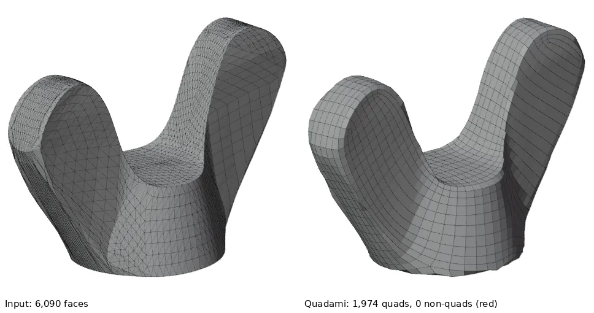

Panel rows flagged: none.

> Panel: Folded input: 1 faces in 1 spots, where the surface folds over itself. The quads there may come out messy or with holes.

### Boat (panels and sharp rims)

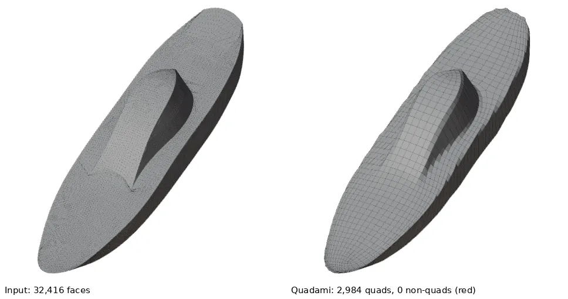

Panel rows flagged: none.

> Panel: Folded input: 4 faces in 2 spots, where the surface folds over itself. The quads there may come out messy or with holes.

### Demosthenes (photoscan, open base)

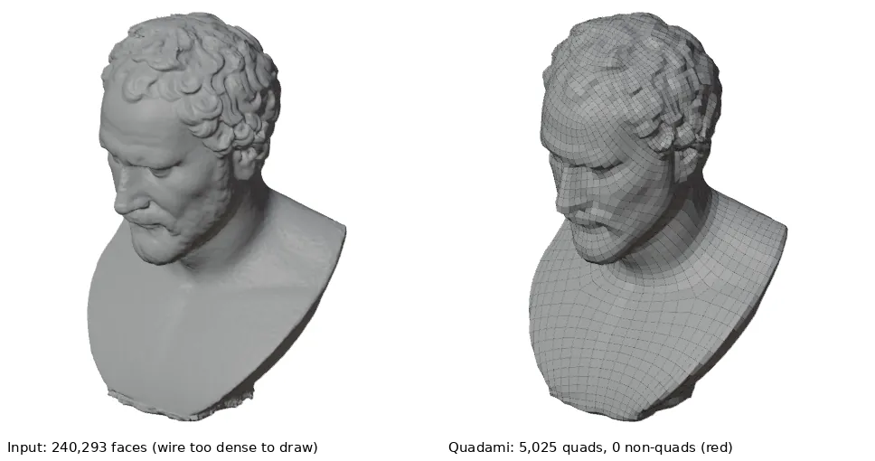

Panel rows flagged: Handles: 3 lost.

> Panel: Output has 3 handles fewer than the input (tunnels or loops closed up, on 1 island): handles only a few quads around close up. A higher Target Quads keeps more of them
> Panel: 1 % of the surface (20 spots) is thinner than one quad at 5000 target quads, a limit of Target Quads rather than a remeshing error: expect folds or lost parts there. At least 11000 target quads (an estimate) would fit a quad across about half of it, but each raise also reveals thinner parts, so it can take several raises; thickening those parts also works
> Panel: To thicken a part: Tab into Edit Mode, select it, press Alt+S (Shrink/Fatten) and move the mouse outwards.
> Panel: Folded input: 500 faces in 364 spots, where the surface folds over itself. The quads there may come out messy or with holes.

### Dyntopo sculpt (procedural)

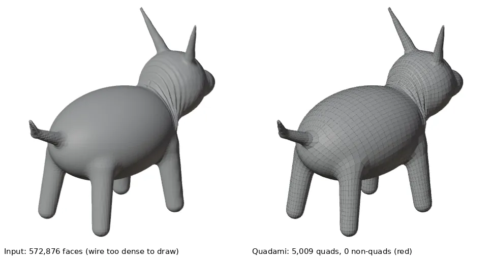

Panel rows flagged: none.

> Panel: Folded input: 122 faces in 30 spots, where the surface folds over itself. The quads there may come out messy or with holes.

### Sculpted box with folded input

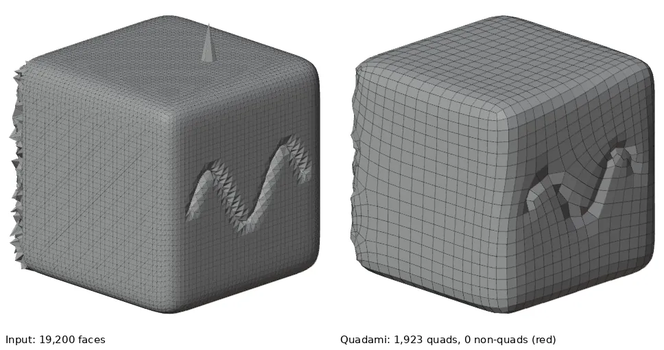

Panel rows flagged: Folded faces: 1; Missing parts: up to 3 quad widths.

> Panel: Parts that are not thinner than a quad are missing (up to 3 quad widths away), so Target Quads may not be the cause. If raising it does not bring them back, please report it.
> Panel: 4 % of the surface (4 spots) is thinner than one quad at 2000 target quads, a limit of Target Quads rather than a remeshing error: expect folds or lost parts there. At least 9800 target quads (an estimate) would fit a quad across about half of it, but each raise also reveals thinner parts, so it can take several raises; thickening those parts also works
> Panel: To thicken a part: Tab into Edit Mode, select it, press Alt+S (Shrink/Fatten) and move the mouse outwards.
> Panel: Folded input: 91 faces in 26 spots, where the surface folds over itself. The quads there may come out messy or with holes.

### Same box, Repair Folds on

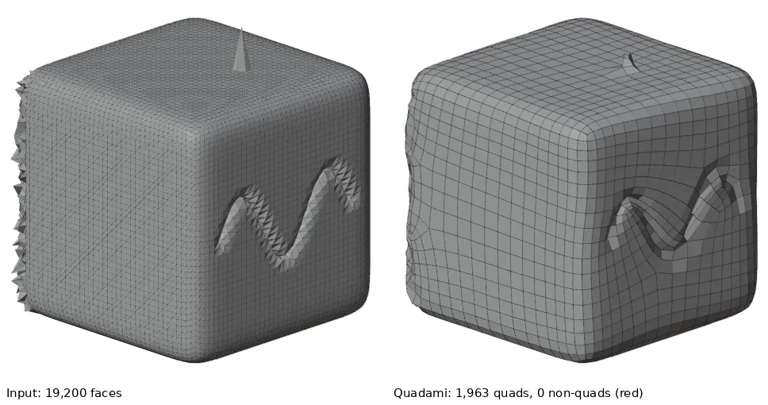

Panel rows flagged: Folded faces: 1; Folds left: 16 faces in 14 spots.

> Panel: 16 folded faces in 14 spots could not be repaired safely and were left as they were.

### Arming sword at 1,000 quads (thin parts)

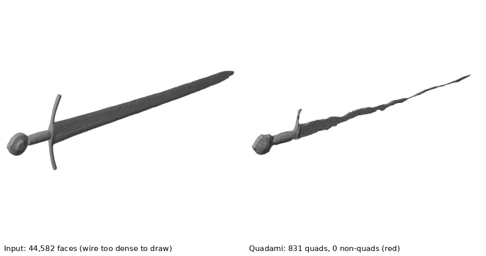

Panel rows flagged: Folded faces: 16; Missing parts: up to 5 quad widths.

> Panel: Parts thinner than one quad are missing (up to 5 quad widths away). At 1000 target quads there is no room for them: a limit of Target Quads, not a remeshing error. Raise Target Quads (1.5 to 8 times as many brought such parts back on most test models), though each raise can show finer parts still too thin; or thicken them.
> Panel: 75 % of the surface (2 spots) is thinner than one quad at 1000 target quads, a limit of Target Quads rather than a remeshing error: expect folds or lost parts there. At least 7600 target quads (an estimate) would fit a quad across about half of it, but each raise also reveals thinner parts, so it can take several raises; thickening those parts also works
> Panel: To thicken a part: Tab into Edit Mode, select it, press Alt+S (Shrink/Fatten) and move the mouse outwards.
> Panel: Folded input: 110 faces in 69 spots, where the surface folds over itself. The quads there may come out messy or with holes.

### Same sword at 3,000 quads

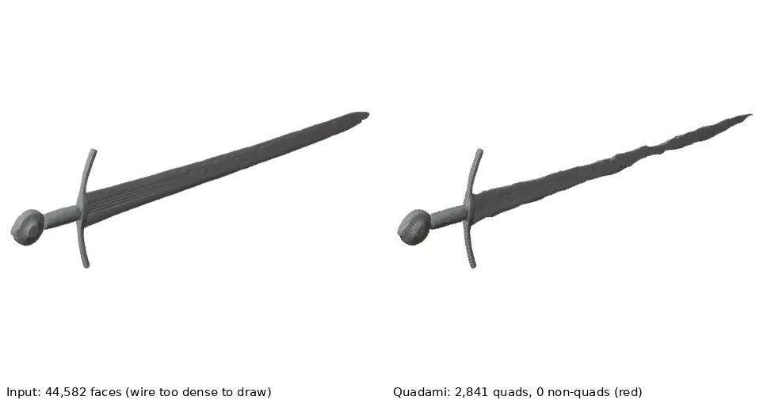

Panel rows flagged: Folded faces: 5.

> Panel: 68 % of the surface (4 spots) is thinner than one quad at 3000 target quads, a limit of Target Quads rather than a remeshing error: expect folds or lost parts there. At least 12000 target quads (an estimate) would fit a quad across about half of it, but each raise also reveals thinner parts, so it can take several raises; thickening those parts also works
> Panel: To thicken a part: Tab into Edit Mode, select it, press Alt+S (Shrink/Fatten) and move the mouse outwards.
> Panel: Folded input: 110 faces in 69 spots, where the surface folds over itself. The quads there may come out messy or with holes.

### Cat (dense sculpt, 1.7M triangles)

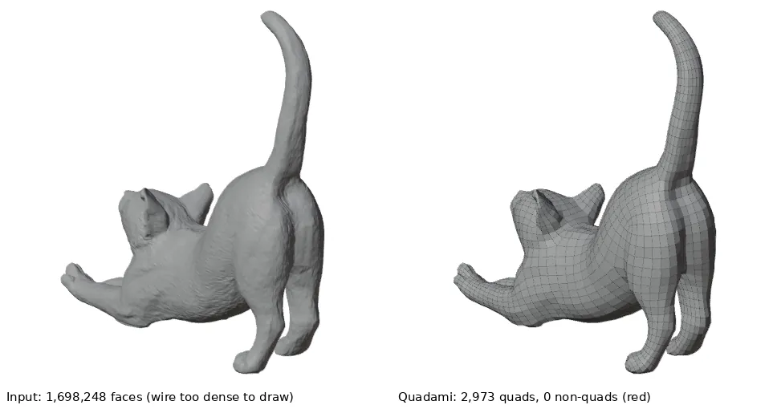

Panel rows flagged: none.

> Panel: Folded input: 137 faces in 34 spots, where the surface folds over itself. The quads there may come out messy or with holes.

### Hammer (raw scan)

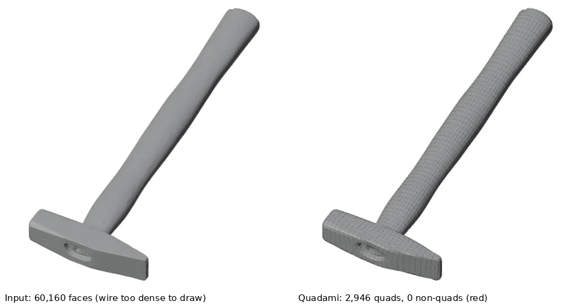

Panel rows flagged: none.

> Panel: Folded input: 35 faces in 31 spots, where the surface folds over itself. The quads there may come out messy or with holes.

### Plane (thin wings)

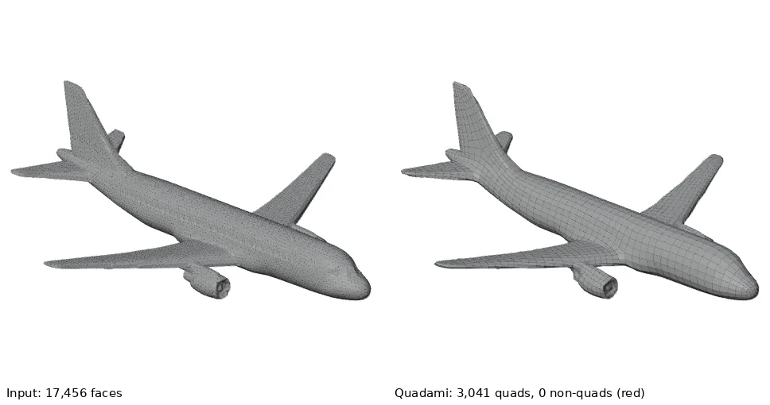

Panel rows flagged: none.

> Panel: 10 % of the surface (19 spots) is thinner than one quad at 3000 target quads, a limit of Target Quads rather than a remeshing error: expect folds or lost parts there. At least 4400 target quads (an estimate) would fit a quad across about half of it, but each raise also reveals thinner parts, so it can take several raises; thickening those parts also works
> Panel: To thicken a part: Tab into Edit Mode, select it, press Alt+S (Shrink/Fatten) and move the mouse outwards.

<!-- gallery-table:end -->

## Limits and what the panel should say

Seeds for a limits page and for the panel's warnings, from the runs above. Measured means in the
table or the run folders; proposed wording is a suggestion, not implemented. Nothing below
claims a fix. Written at `0e9bec8`; since then item 1 has a panel warning (thin parts and missing
parts, user guide §6).

1. **Thin parts lose shape silently.** The sword at 1,000 quads: in all 5 runs part of the guard or
   the blade tip is missing or shortened (shape error 2.0-29.7 % of the diagonal; the other meshes
   stay at or below 0.2 %). The panel shows only "Folded faces: 11", no holes, no warning, and the
   topology still matches the input, so no existing check notices. At 3,000 quads the guard is
   back, but the blade is ragged near the tip (1.0-1.1 %). Measured. *Proposed warning, once the
   core reports a shape distance:* "Parts of the result are far from your mesh (up to N % of its
   size), usually parts thinner than a quad. Raise Target Quads, or thicken the part
   (Solidify)." Needs a distance check in the core; its cost on dense inputs is not measured yet.
2. **The folded-input warning fires too often and names the wrong cause.** It appeared on 8 of the
   10 runs (all but Spot and the repaired box), including the wing nut (CAD, 1 folded face) and the
   koala (4 faces), whose outputs have no defect in any of the 5 runs, and the Demosthenes
   photoscan (629 faces in 400 spots); its text blames "a sculpt brush" on scans and CAD
   parts, and says "1 faces in 1 spots". Measured. *Proposed:* show it only above a size or count
   threshold that predicts a defect (to be fitted on the brush and sculpt sets), say "Folded input
   (faces that turn back over their neighbours)" without naming a tool, and fix the plurals.
3. **Repair Folds leaves spots and can count wrongly.** On the sculpted box it cleared the output
   folds (1-3 to 0 over 5 runs) but left 19 of 26 input spots, and the spike on top stays. On
   `brush_layers` at 5,000 (pleats; brush set, not in this gallery) the repair split 3 spots into
   32 smaller ones, and the panel row reads "Folds repaired: -29 of 3 spots" (report.py subtracts
   the after count from the before count). Measured on one run; the arithmetic is deterministic.
   *Proposed:* report "N of M folded faces repaired" (faces, not clusters), and never a negative.
4. **Non-quads on sharp rims flip with noise.** The boat gives 0 to 6 non-quads and 0 to 3 folded
   faces over 5 inputs that differ by one ulp. Measured. *Proposed wording for the guide:* "A few
   triangles or pentagons along sharp edges are normal; running again with Target Quads a little
   higher or lower usually changes them."
5. **Counts land near, not on, the target.** 619-871 quads for a 1,000 target on the sword, 94-102 %
   elsewhere. The panel already shows the percentage; the guide should say thin parts get fewer
   quads than asked.

## Sources and licenses

The downloaded meshes shown here come from [odedstein/meshes](https://github.com/odedstein/meshes)
pinned at commit `8352132` (`tools/bench/fetch_meshes.sh`, SHA-256 in `tools/bench/meshes.tsv`).
License as stated in each object's README there, read on 2026-10-22. Renders of a CC BY mesh are
adaptations: they need the credit below, a link to the license, and a note that it was changed
(remeshed).

| Mesh | Author / source | License (per odedstein README) | Note |
|---|---|---|---|
| spot | Keenan Crane | Public domain (author's dedication) | |
| koala | YahooJAPAN, [thingiverse 182225](https://www.thingiverse.com/thing:182225); remesh by Oded Stein | CC BY 3.0 | |
| wingnut | Oded Stein, Eitan Grinspun, Keenan Crane | CC BY 4.0 | |
| boat | Oded Stein, Eitan Grinspun, Keenan Crane | CC BY 4.0 | |
| demosthenes | ryanfb, [Sketchfab "Louvre Demosthenes photoscan"](https://sketchfab.com/3d-models/louvre-demosthenes-photoscan-cf5d9dd9bf4a457c95dc76e17848727b); modified by Oded Stein | CC BY 4.0 | The statue is ancient; the license covers the scan. |
| sword | The Oakeshott Institute, [Sketchfab "Moonbrand" arming sword](https://sketchfab.com/3d-models/moonbrand-early-14th-c-arming-sword-80fa91fc8c974fd0acd2a55cc513edec); modified by Oded Stein | CC BY 4.0 | Not related to any private sword model of the project. |
| cat | billyd, [thingiverse 1565405](https://www.thingiverse.com/thing:1565405); remesh by Oded Stein | CC BY 4.0 | |
| hammer | Andrea Spognetta (Spogna), [Sketchfab "Hammer rawscan"](https://sketchfab.com/3d-models/hammer-rawscan-01e5b5acad9843818529d15663df5b9e); modified by Oded Stein | CC BY 4.0 | |
| plane | YahooJAPAN, [thingiverse 182252](https://www.thingiverse.com/thing:182252); remesh by Oded Stein | CC BY 3.0 | |

Procedural meshes are generated by our GPL scripts from code alone, so their renders carry no third-party
license: `sculpt_dyntopo` (`tools/bench/make_sculpt.py`), `brush_box_relief`
(`make_sculpt.py --set brush`), and `make_synthetic.py`'s meshes. Blender's Suzanne (`make_suzanne.py`)
is left out: renders of it are common, but its license status was not checked.

Credits for the images on this page: spot by Keenan Crane (public domain); koala by YahooJAPAN, CC BY
3.0; wing nut and boat by Oded Stein, Eitan Grinspun and Keenan Crane, CC BY 4.0; Demosthenes
photoscan by ryanfb, CC BY 4.0; "Moonbrand" arming sword by The Oakeshott Institute, CC BY 4.0; cat
by billyd, CC BY 4.0; hammer by Andrea Spognetta, CC BY 4.0; plane by YahooJAPAN, CC BY 3.0; all
via github.com/odedstein/meshes, remeshed by Quadami. The images themselves are offered under the
same licenses as their meshes.

## Rebuild

```bash
python3 -m pip install bpy==5.2.2 numpy pillow scipy libigl scikit-image   # Python 3.13
W=~/ar-work
tools/bench/fetch_meshes.sh $W/meshes
python3 tools/bench/make_sculpt.py --out $W/meshes/sculpt --only sculpt_dyntopo
python3 tools/bench/make_sculpt.py --set brush --out $W/meshes/brush --only brush_box_relief
python3 tools/bench/ab.py build master --work $W --jobs 4    # optional: gallery.py builds with 1 job
python3 tools/gallery/gallery.py --ref master --work $W      # about 10 minutes on 4 cores
```

On Linux without a display, bpy's Workbench renderer needs `libegl1`. The entries (mesh, target,
camera, title) are the `gallery` set in `tools/bench/corpus.json`; `--only a,b` re-renders single
entries without touching the table. Images are WebP, 968 x 510, about 30 KB each.
